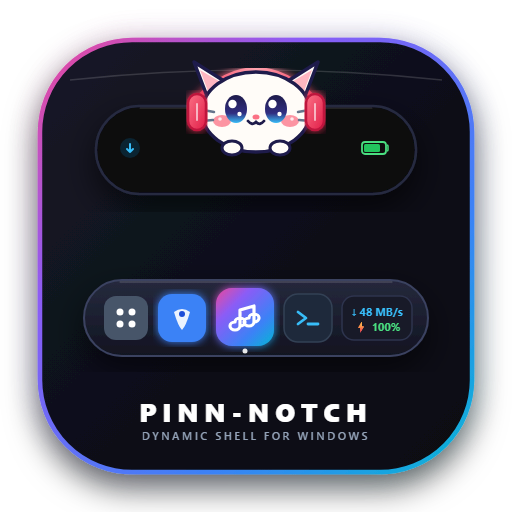

<p align="center">
  
</p>

<h1 align="center">Pinn-Notch 🚀</h1>

<p align="center">
  <b>The Ultimate macOS-Style Floating Dock & Dynamic Island Experience for Windows 10 & 11</b>
</p>

<p align="center">
  <a href="https://github.com/Gimm17/Pinn-Notch/releases/latest">
    
  </a>
  
  
  <a href="LICENSE">
    
  </a>
  <a href="https://github.com/Gimm17/Pinn-Notch/stargazers">
    
  </a>
</p>

---

## 🌟 Overview

**Pinn-Notch** is a powerful desktop companion and productivity shell for Windows. It fuses the elegance of Apple's **macOS Floating Dock** with an interactive **Dynamic Island Notch**, seamlessly integrated with real-time hardware telemetry, media playback, translucent taskbars, and privacy controls.

> ℹ️ **Open Source Attribution**: Pinn-Notch is an enhanced fork and derivative work of [V-Notch by w0otdev](https://github.com/w0otdev/V-Notch), developed under the **Apache License 2.0**. All enhancements, original architectural additions, and standalone modules are actively maintained by [Gimm17](https://github.com/Gimm17).

---

## ✨ Exclusive Features in Pinn-Notch

### 1. 🖥️ macOS-Style Floating Bottom Dock
* **Smooth Physics & Magnification:** Hover over dock icons for parabolic zoom physics with customizable scaling and frosted acrylic blur.
* **Auto-Hide & Screen Collision:** Automatically dodges active maximized windows and slides down; smoothly reveals on bottom screen edge touch.
* **Event-Driven 0ms Window Tracking:** Powered by native Win32 `SetWinEventHook` for zero-latency active window tracking.
* **Fullscreen Game Shield:** Automatically suspends dock polling and rendering when playing fullscreen 3D/DirectX/Vulkan games for 0% CPU impact.

### 2. 📊 Rigid System Status Bar Capsule (Anti-Jitter)
* **Real-Time Internet Speed Meter:** Download & upload speed with Byte standardization (`B/s`, `KB/s`, `MB/s`, `GB/s`). Fixed-width container prevents dock twitching regardless of digit length.
* **Seamless Apple-Style Battery:** Single-silhouette fused battery nub with zero-gap geometry and an integrated vector charging bolt (`⚡`).
* **Scroll-to-Adjust Master Volume:** Quick volume mute/unmute via click, plus **mouse wheel scrolling** anywhere on the volume capsule to adjust master volume by $\pm 2\%$.

### 3. 🪟 Translucent Taskbar & Freeze Engine
* **Native Taskbar Transparency:** Deep integration with TranslucentTB's native Windows composition engine.
* **Taskbar Freeze Synchronization:** Automatically hides or freezes the default Windows Taskbar in sync with the Pinn-Notch dock.

### 4. 📷 Interactive Camera Companion
* **Instant Auto-Start:** Webcam hardware activates automatically upon opening the Camera tab.
* **Live Mirror / Flip:** Toggle horizontal flip with an interactive frosted glass button or by **right-clicking anywhere** on the camera preview.

### 5. 🎵 Smart Media & WebView2 Video Throttling
* **YouTube Music & Spotify Integration:** Synced lyrics, album art blur, and playback controls.
* **Zero-GPU Background Throttling:** Automatically hides video and canvas elements when minimized, saving up to 900MB RAM and reducing GPU usage to ~0%.

---

## 🚀 Getting Started

### Prerequisites
* Windows 10 (version 19041+) or Windows 11 (x64)
* [.NET 8.0 Desktop Runtime](https://dotnet.microsoft.com/download/dotnet/8.0)

### Building from Source
```powershell
# Clone repository
git clone https://github.com/Gimm17/Pinn-Notch.git
cd Pinn-Notch

# Build Release
dotnet build V-Notch.csproj -c Release -p:SkipNativeCompile=true

# Launch Pinn-Notch
.\bin\Release\net8.0-windows10.0.19041.0\win-x64\Pinn-Notch.exe
```

---

## ⌨️ Shortcuts & Interaction

| Shortcut | Description |
|---|---|
| `Win + Alt + Space` | Open Pinn-Notch Settings (Customizable) |
| `Alt + Space` | Spotlight Search & App Launcher |
| Mouse Wheel on Volume Widget | Adjust Volume ($\pm 2\%$) |
| Right-Click on Camera Preview | Mirror / Flip Camera View |

---

## 📜 License & Acknowledgments

This project is licensed under the [Apache License 2.0](LICENSE).
* Original base project: [V-Notch](https://github.com/w0otdev/V-Notch) by w0otdev.
* Translucent taskbar composition: inspired by [TranslucentTB](https://github.com/TranslucentTB/TranslucentTB).
* Maintained & Developed by **Gimm17**.
