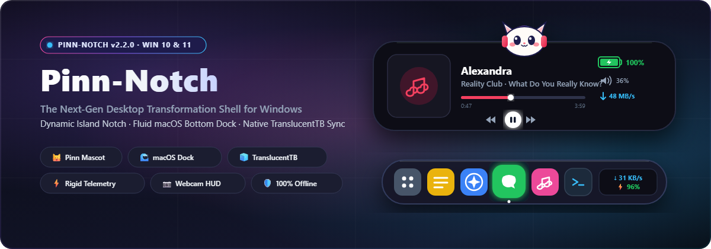
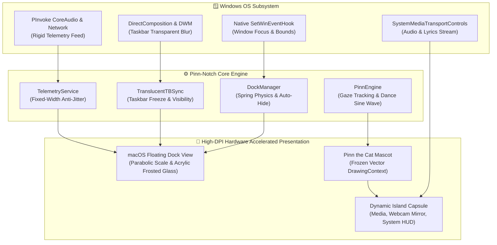

<p align="center">
  
</p>

<p align="center">
  <a href="https://github.com/Gimm17/Pinn-Notch/releases">
    
  </a>
  
  
  <a href="LICENSE">
    
  </a>
  
  <a href="https://github.com/Gimm17/Pinn-Notch/stargazers">
    
  </a>
</p>

<p align="center">
  <b>Pinn-Notch</b> transforms your Windows desktop into an ultra-fluid workspace combining a <b>macOS-style floating dock</b>, an interactive <b>dynamic island notch capsule</b>, real-time <b>rigid hardware telemetry</b>, and the lovable <b>Pinn the Cat companion</b> — with 0ms event-driven performance and zero cloud telemetry.
</p>

<p align="center">
  <a href="#-core-highlights">✨ Highlights</a> ·
  <a href="#-feature-showcase">🌊 Feature Showcase</a> ·
  <a href="#-pinn-notch-vs-traditional-shells">📊 Comparison</a> ·
  <a href="#-system-architecture">📐 Architecture</a> ·
  <a href="#-installation--quickstart">🚀 Quickstart</a> ·
  <a href="#-keyboard--mouse-gestures">⌨️ Shortcuts</a> ·
  <a href="#-privacy--standalone-guarantee">🛡️ Privacy</a> ·
  <a href="#-open-source-attribution">📜 Attribution</a>
</p>

---

## ✨ Core Highlights

<table>
  <tr>
    <td width="50%" valign="top">
      <h3>🌊 Fluid macOS-Style Floating Dock</h3>
      <ul>
        <li><b>Parabolic Spring Physics:</b> Smooth magnification zoom on cursor hover with configurable scale, bounce, and acrylic blur.</li>
        <li><b>Window Collision Dodge:</b> Automatically slides down when maximized windows are active; smoothly resurfaces on bottom edge contact.</li>
        <li><b>0ms Win32 Event Hooks:</b> Event-driven tracking via native <code>SetWinEventHook</code> with zero background timer polling.</li>
        <li><b>Fullscreen Game Shield:</b> Suspends rendering and polling during fullscreen 3D/DirectX/Vulkan games for 0% CPU impact.</li>
      </ul>
    </td>
    <td width="50%" valign="top">
      <h3>🐱 Pinn the Cat Interactive Companion</h3>
      <ul>
        <li><b>Real-Time Gaze Tracking:</b> Pinn sits adorably atop the notch, following your mouse cursor with smooth vector-rendered eye movements.</li>
        <li><b>Music Dancing &amp; Headphones:</b> Puts on mini headphones and bobs her head in rhythm with YouTube Music or Spotify playback.</li>
        <li><b>Playful Micro-Interactions:</b> Click Pinn to trigger happy spring bounces with floating hearts; drifts into gentle sleeping "Zzz" when idle.</li>
        <li><b>Zero-GC Vector Rendering:</b> Rendered entirely with frozen vector brushes for absolute 60 FPS performance and 0 memory leaks.</li>
      </ul>
    </td>
  </tr>
  <tr>
    <td width="50%" valign="top">
      <h3>🧊 Native TranslucentTB &amp; Taskbar Freeze</h3>
      <ul>
        <li><b>TranslucentTB Engine Integration:</b> Built-in native Windows composition hooks without requiring separate external utility processes.</li>
        <li><b>Taskbar Freeze Sync:</b> Automatically hides and freezes the default Windows Taskbar in synchronized harmony with the Pinn-Notch dock.</li>
        <li><b>Multi-Monitor Aware:</b> Seamlessly handles primary and secondary taskbars across multi-display setups.</li>
      </ul>
    </td>
    <td width="50%" valign="top">
      <h3>⚡ Rigid Anti-Jitter Status Telemetry</h3>
      <ul>
        <li><b>Standardized Byte Speedometer:</b> Real-time network speed in <code>B/s</code>, <code>KB/s</code>, <code>MB/s</code>, and <code>GB/s</code> within a strictly fixed-width container. No dock jittering!</li>
        <li><b>Seamless Apple Battery:</b> Single-silhouette fused battery body with zero-gap geometry and an integrated green charging bolt (<code>⚡</code>).</li>
        <li><b>Scroll-to-Adjust Master Volume:</b> Scroll your mouse wheel anywhere over the volume capsule to adjust volume by ±2%.</li>
      </ul>
    </td>
  </tr>
  <tr>
    <td width="50%" valign="top">
      <h3>📷 Instant Studio Webcam &amp; Mirror HUD</h3>
      <ul>
        <li><b>0ms Auto-Start:</b> Hardware camera feed initializes instantly upon opening the Camera tab.</li>
        <li><b>One-Click Live Mirroring:</b> Toggle horizontal flip with an on-screen frosted glass button or by <b>right-clicking anywhere</b> on the feed.</li>
        <li><b>Clean Studio View:</b> Compact floating viewfinder for quick appearance checks before meetings or video calls.</li>
      </ul>
    </td>
    <td width="50%" valign="top">
      <h3>🎵 Zero-GPU Background Media Throttling</h3>
      <ul>
        <li><b>Spotify &amp; YouTube Music:</b> Real-time synced lyrics, album cover art blur, and full media transport controls.</li>
        <li><b>Smart Video Throttling:</b> Automatically suppresses video/canvas elements when the notch is minimized, saving up to <b>900MB RAM</b> and dropping GPU usage to 0%.</li>
      </ul>
    </td>
  </tr>
</table>

---

## 🌊 Feature Showcase

### 1. The Rigid Telemetry Capsule
In traditional dynamic docks, variable text length causes the dock to twitch and shift position as download speeds bounce between 1 and 3 digits. Pinn-Notch solves this with:
* **Fixed-Width Rigid Columns:** Mathematical bounds lock the speedometer in place regardless of whether speed is `4 B/s` or `948 MB/s`.
* **Standard Byte Standardization:** Strict Byte notation (`KB/s`, `MB/s`) for precise, engineer-grade bandwidth monitoring.
* **Fused Apple Battery Silhouette:** True Apple-style single-contour rounded battery body with green reactive charging indicators.

### 2. The Interactive Floating Dock
* **Smart Edge Proximity:** Dock reveals when touching the screen bottom and tucks away gracefully when focus returns to active fullscreen apps.
* **App Pinned Shelf:** Pin your favorite apps, folders, and web shortcuts with custom high-DPI icon scaling.
* **Native Taskbar Suppression:** Enjoy an unobstructed macOS desktop look without third-party taskbar tweakers conflicting.

### 3. Pinn the Cat Mascot
* Sitting perched on the dynamic island, Pinn gives life to your workspace:
  * **Hover & Gaze:** Pupils track your mouse across the monitor.
  * **Audio Groove:** Listens to active system audio sessions and dances with headphones.
  * **Customizable Placement:** Position Pinn on the Left, Center, or Right of the Notch, or toggle off whenever you require deep focus.

---

## 📊 Pinn-Notch vs. Traditional Shells

| Feature / Capability | Default Windows 10/11 | Vanilla Upstream Notches | **Pinn-Notch (Gimm17)** |
|:---|:---:|:---:|:---:|
| **macOS Floating Bottom Dock** | ❌ None | ❌ None | **✅ Full Parabolic Spring Physics** |
| **Native TranslucentTB Engine** | ❌ External app required | ❌ External app required | **✅ Built-in Native Composition Sync** |
| **Network Speed Display** | ❌ Task Manager only | ⚠️ Unstable / Jittery size | **✅ Rigid Anti-Jitter Fixed-Width (Byte)** |
| **Apple Battery Indicator** | ❌ Segmented Tray Icon | ⚠️ Disjointed nub & text | **✅ Single-Silhouette Fused Apple Nub** |
| **Desktop Mascot Companion** | ❌ None | ❌ None | **✅ Interactive Pinn the Cat (Vector)** |
| **Fullscreen Game Shield** | ❌ Manual auto-hide | ⚠️ Partial | **✅ 0ms Auto-Suspend (0% CPU impact)** |
| **Webcam Instant Mirror** | ❌ Camera app only | ⚠️ Basic preview | **✅ Auto-Start + Right-Click Live Flip** |
| **Media Player GPU Throttling** | ❌ Runs full video | ⚠️ High background VRAM | **✅ Auto-Suppression (~900MB RAM saved)** |
| **Telemetry & Cloud Connection** | ⚠️ Windows Diagnostics | ⚠️ External update checks | **✅ 100% Offline / Fully Decoupled** |

---

## 📐 System Architecture

Pinn-Notch is built with a high-performance C# / WPF frontend backed by low-latency Win32 native C++ sub-engines:



---

## 🚀 Installation & Quickstart

### System Requirements
* **Operating System:** Windows 10 (Version 19041+) or Windows 11 (64-bit x64)
* **Runtime:** [.NET 8.0 Desktop Runtime (x64)](https://dotnet.microsoft.com/download/dotnet/8.0)
* **Graphics:** DirectX 11 compatible GPU with DWM hardware acceleration enabled

### Method 1: Download Release
1. Grab the latest release archive from [Releases](https://github.com/Gimm17/Pinn-Notch/releases).
2. Extract the archive to your preferred directory (e.g. `C:\Program Files\Pinn-Notch` or your user folder).
3. Run `Pinn-Notch.exe`.

### Method 2: Building from Source
Ensure you have the [.NET 8 SDK](https://dotnet.microsoft.com/download) installed:

```powershell
# 1. Clone repository
git clone https://github.com/Gimm17/Pinn-Notch.git
cd Pinn-Notch

# 2. Build Release binary
dotnet build V-Notch.csproj -c Release -p:SkipNativeCompile=true

# 3. Launch Pinn-Notch
.\bin\Release\net8.0-windows10.0.19041.0\win-x64\Pinn-Notch.exe
```

---

## ⌨️ Keyboard & Mouse Gestures

| Gesture / Shortcut | Target Component | Action |
|:---|:---|:---|
| `Win + Alt + Space` | Global | Open Pinn-Notch Settings Window |
| `Alt + Space` | Global | Open Spotlight App Launcher & Search |
| **Mouse Hover** | Bottom Dock Icons | Parabolic Spring Magnification Zoom |
| **Bottom Edge Contact** | Screen Bottom | Reveal Auto-Hidden Floating Dock |
| **Mouse Wheel Scroll** | Volume Capsule | Precision Master Volume Adjustment (±2%) |
| **Right-Click** | Studio Camera View | Instant Horizontal Mirror / Flip |
| **Left-Click** | Pinn the Cat Mascot | Happy Bounce with Floating Heart Animation |
| **Triple-Click** | Dynamic Notch Capsule | Ghost / Focus Mode (Semi-transparent click-through) |

---

## 🛡️ Privacy & Standalone Guarantee

Pinn-Notch is committed to uncompromising privacy and zero telemetry:
* **100% Offline-Safe:** No background phone-home calls, analytics trackers, or external telemetry pings.
* **Decoupled Architecture:** Upstream auto-updater scripts and external endpoints have been completely purged; all updates are user-initiated and transparent.
* **Local DPAPI Encryption:** User preferences and media tokens are stored strictly on your local machine under `%APPDATA%\Pinn-Notch\` encrypted using Windows Data Protection API (DPAPI).

---

## 📜 Open Source Attribution

Pinn-Notch is released under the **[Apache License 2.0](LICENSE)**.

* **Upstream Heritage:** Derivative work and enhanced fork of [V-Notch](https://github.com/w0otdev/V-Notch) originally by w0otdev.
* **Taskbar Composition:** Architecture inspired by and adapted from the open-source [TranslucentTB](https://github.com/TranslucentTB/TranslucentTB) project.
* **Lead Maintainer & Developer:** Developed, branded, and actively maintained by **[Gimm17](https://github.com/Gimm17)**.

<p align="center">
  <sub>Pinn-Notch is an independent community project. All trademarks and registered trademarks are the property of their respective owners.</sub>
</p>
